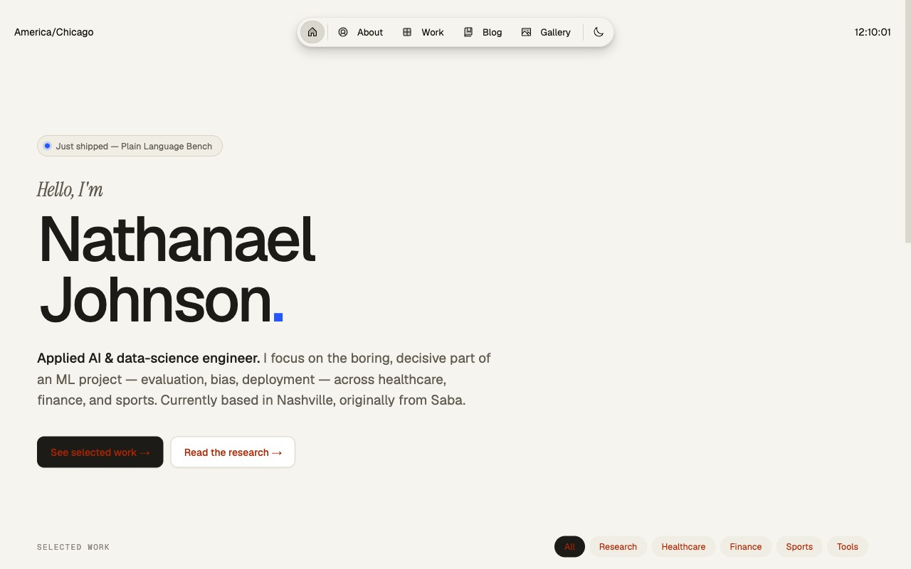

# Nathanael Johnson — Portfolio

Personal portfolio of Nathanael Johnson, an applied AI and data science engineer based in Nashville,
originally from Saba. 48 projects, each with a case study and a link to its source, plus a blog and a
photo gallery.

**Live site:** [nathanaeljohnson.net](https://www.nathanaeljohnson.net)



## What's on it

- **Work** (`/work`): every project, filterable by domain (Civic, Research, Production ML, Tools,
  Systems, ML Foundations, Analysis, Healthcare, Finance, Sports) and sortable by tier, date or domain.
  Recent highlights:
  - **Civic tools with Claude**, built in fall 2026: a fact-checked digest of Nashville's Metro Council
    ([Nashville Council Digest](https://nathanaelhub.github.io/nashville-council-digest/)), a cited
    Tennessee benefits screener, an address lookup for nearby rezonings and permits
    ([Nashville Near Me](https://nathanaelhub.github.io/nashville-near-me/)), a WeGo bus on-time
    tracker, an accessibility report for nonprofit websites, and a benchmark of what plain-language
    rewrites of federal letters lose ([Plain Language Bench](https://nathanaelhub.github.io/plain-language-bench/)).
  - **LLM evaluation research**: mental health LLM bias evaluation, and judge-audit, which measures how
    far an LLM judge's verdicts can be trusted.
  - **ML from scratch**: a GPT, a diffusion model and backpropagation in NumPy; a C++ N-body
    simulation; a Rust backtester.
- **About** (`/about`): education, experience and skills.
- **Blog** (`/blog`): six posts on ethics, statistics and data engineering.
- **Gallery** (`/gallery`): photography.

## Stack

- **Next.js 15** (App Router) with static export (`output: "export"`)
- **Once UI** (Magic Portfolio template) and CSS modules
- **MDX** for project case studies and blog posts
- **TypeScript**
- **GitHub Pages** with a custom domain, deployed by GitHub Actions

## Run

```bash
git clone https://github.com/nathanaelhub/my-portfolio.git
cd my-portfolio
npm install
npm run dev        # → http://localhost:3000
```

To check the production build (static export, so `next start` doesn't apply):

```bash
npm run build                          # writes out/
cd out && python3 -m http.server 8000  # → http://localhost:8000/work.html
```

## Adding a project

1. **Case study:** `src/app/work/projects/<slug>.mdx`, with frontmatter:

   ```yaml
   title: "Project Name"
   publishedAt: "2026-11-11"
   summary: "One or two sentences on what it is and why it matters."
   link: "https://github.com/nathanaelhub/<repo>"
   tag: "Civic / LLM Evaluation"
   tier: "featured"            # featured | production | tools | analysis
   domains: ["Civic", "Tools"] # drive the filters on /work
   year: 2026
   metric: "the one number that sums it up"
   isNew: true
   ```

   The body follows the same four sections as the others: The brief, The build, What I learned, Stack.

2. **Cover art:** an SVG component in `src/components/covers/CoverArt.tsx`, registered with its tint
   and accent colors in `src/components/covers/index.tsx` under the same slug. A project without one
   shows a blank cover.

3. **New filter (only if needed):** filters live in `src/components/work/WorkExplorer.tsx`.

The homepage's "Just shipped" label names the most recently published project; the top project on the
homepage is pinned with `MARQUEE_SLUG` in `src/app/page.tsx`.

## Other content

| What | Where |
|---|---|
| Name, role, bio, experience, social links | `src/resources/content.tsx` |
| Theme and site settings | `src/resources/once-ui.config.ts` |
| Blog posts | `src/app/blog/posts/<slug>.mdx` |
| Avatar | `public/images/avatar.jpg` |
| Gallery photos | `public/images/gallery/` |

## Deployment

Every push to `main` runs `.github/workflows/simple-deploy.yml`: it builds the static export, checks
that the key pages and images are present, and deploys `out/` to GitHub Pages (about 5 minutes).
`public/CNAME` serves the site at nathanaeljohnson.net from the root, so there's no base path. The
other two workflows (`deploy.yml`, `custom-crawl-deploy.yml`) are older methods kept for manual use
only.

## Links

- **GitHub:** [nathanaelhub](https://github.com/nathanaelhub)
- **LinkedIn:** [nathanaeljdjohnson](https://www.linkedin.com/in/nathanaeljdjohnson/)
- **Medium:** [@nathanaeljdj](https://medium.com/@nathanaeljdj)
- **X:** [@Natex07](https://x.com/Natex07)
- **Email:** nathanaeljdj@gmail.com

## Credits and license

Built on the [Magic Portfolio](https://github.com/once-ui-system/magic-portfolio) template by
[Once UI](https://once-ui.com), created by Lorant One. Licensed CC BY-NC 4.0, as the template is:
attribution required, no commercial use. See `LICENSE.txt`.
